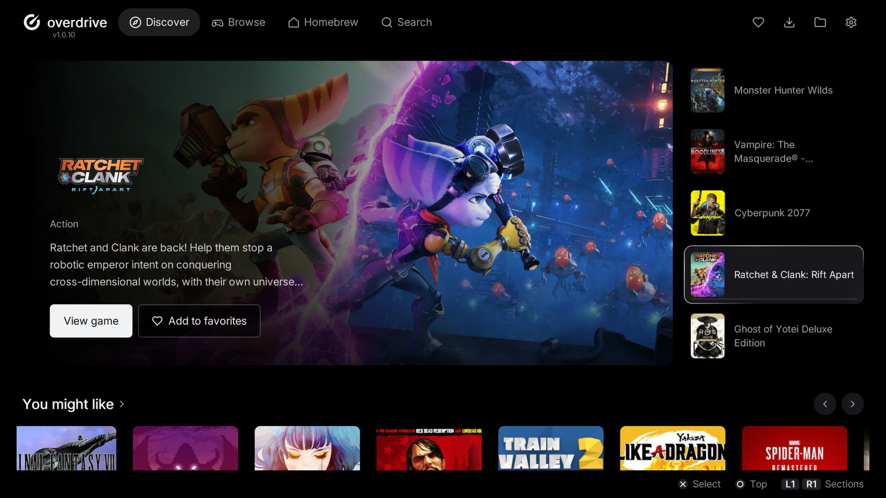
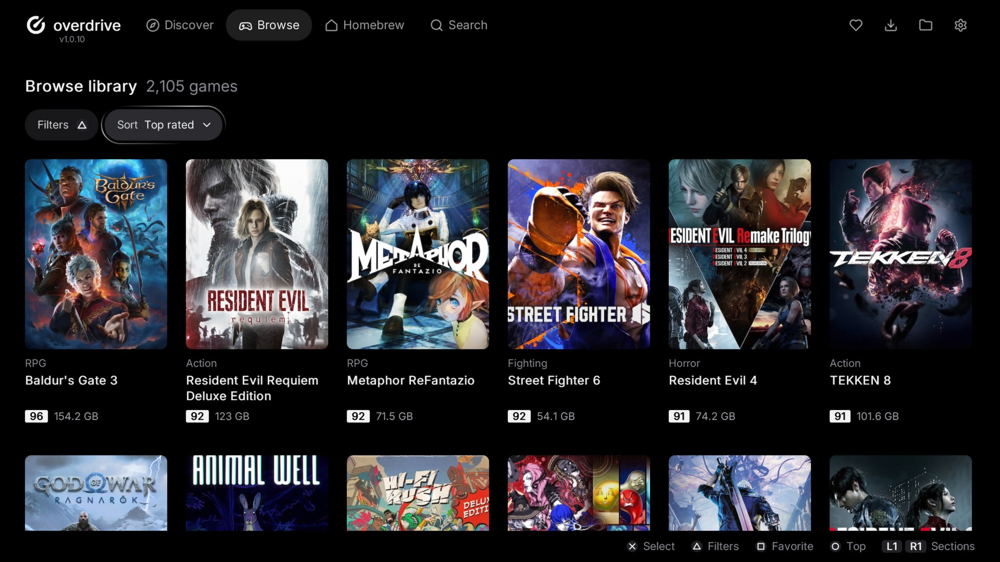
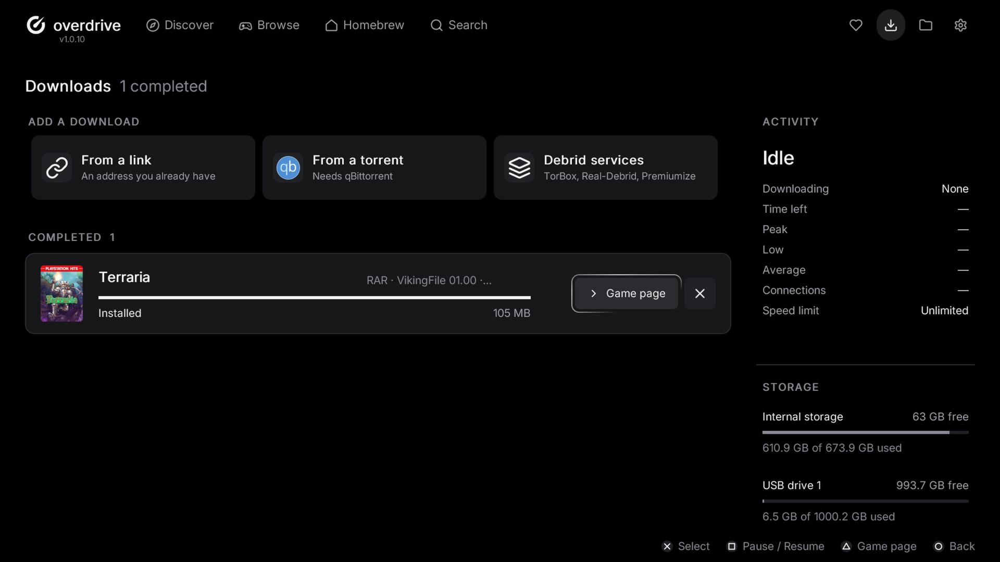

<div align="center" dir="ltr">
  
</div>

<div align="center" dir="ltr">
  <h5><b>English</b> ·
  <a href="README.ru.md">Русский</a></h5>
</div>

<div align="center" dir="ltr">
  <h3><b>Overdrive for PlayStation 4.</b><br>
  The open-source game store, ported from PS5 homebrew to jailbroken PS4 — work in progress.</h3>
</div>

<div align="center" dir="ltr">
  <a href="#status">Status</a> ·
  <a href="#features">Features</a> ·
  <a href="#requirements">Requirements</a> ·
  <a href="#building">Building</a> ·
  <a href="#testing-on-a-console">Testing</a> ·
  <a href="#credits">Credits</a>
</div>

> [!IMPORTANT]
> **Nothing here runs on a console yet.** This repository carries the working port base:
> the full Overdrive codebase, a PS4 native host, and a build pipeline targeting the
> [Open Orbis](https://github.com/OpenOrbis/OpenOrbis-PS4-Toolchain) toolchain. The first
> hardware bring-up is scheduled; until then, treat every artifact as untested. Follow
> [docs/PS4.md](docs/PS4.md) for the live plan and status.

> [!NOTE]
> Overdrive started as a PS5 homebrew store: the original project was closed, its last binary
> was decompiled, and the full source was rebuilt in the open — see
> [gitlab.com/myluxy/overdrive](https://gitlab.com/myluxy/overdrive) and the upstream mirror
> [github.com/Stintik-123/Overdrive](https://github.com/Stintik-123/Overdrive). This repository
> ports that store to the PS4. The interface, the catalog and the architecture are the same;
> only the console-facing layer differs.

<div align="center" dir="ltr">
  
</div>
<div align="center" dir="ltr">
  
  
</div>

*Screenshots come from the PS5 build. The PS4 port renders the same interface through the
same software renderer; on-console screenshots will replace these after the first hardware run.*

## What it is

Overdrive is a game store for jailbroken consoles: browse a catalog of 3,400+ community
downloads, fetch them straight to the console's storage or a USB drive, unpack archives,
and manage files — all from the couch, with a controller. On PS5 it ships as a native
homebrew app under `PPSA99058`. On PS4, the same React interface runs inside QuickJS,
drawn by the same software renderer into a framebuffer, with SDL2 doing input and audio
through the [Open Orbis](https://github.com/OpenOrbis/OpenOrbis-PS4-Toolchain) libc.

The framework behind it — ps5-react (React inside QuickJS + a native C++ host) — is
transportable by design: the platform layer it needs on any console is small, and this
repository holds the PS4 implementation of it under
[`ps5-react/native/ps4`](ps5-react/native/ps4/README.md).

## Status

| Area | State |
| --- | --- |
| Overdrive UI, catalog, i18n (17+ languages) | ✅ inherited unchanged from Overdrive |
| Desktop preview (PC, SDL2) | ✅ works exactly as upstream: `npm run preview` |
| PS4 native host (`ps5-react/native/ps4`) | 🟡 written, **not yet compiled** for Open Orbis |
| Build pipeline (`packaging/build-ps4.sh`, `tools/build_ps4.py`) | 🟡 written, **not yet run** |
| Downloads to internal storage / USB | 🟡 implemented in the host; needs console validation |
| RAR extraction | 🔴 stubbed: no processes on Open Orbis, worker rework pending |
| PKG install assist | 🔴 intentionally out of scope: PKGs stay with HEN tooling |
| Video playback | 🔴 optional FFmpeg port, off by default for now |
| fPKG packaging & install on console | 🔴 pending first hardware session |
| Firmware / HEN compatibility | ❓ unknown until a jailbroken PS4 runs the ELF |

The detailed per-component table, risks and the bring-up checklist live in
[docs/PS4.md](docs/PS4.md).

## Features (target, from upstream)

- **3,400+ games** to discover, with **Top rated**, a hand-picked row and a featured spotlight
- **Browse the whole library** with filters, sorting, scores and download sizes at a glance
- **Downloads straight to the console**, to internal storage or any USB drive, with live speed and storage stats
- **Debrid services** (TorBox, Real-Debrid, Premiumize): paste a link or magnet, the console fetches what the service prepares
- **Favorites**, **search** with an on-screen keyboard, and a **Files** page to see and clean up what's on your drives
- **17+ languages** inherited from the PS5 build
- Made for the controller: <kbd>L1</kbd> <kbd>R1</kbd> to switch sections, <kbd>✕</kbd> to select, <kbd>◯</kbd> to go back

On PS4, features that rely on PS5-only services are replaced with console-appropriate
behavior: PKG install requests report that HEN tooling owns installation, browser-based
catalog capture is unavailable, and self-updates are expected to arrive through the usual
PS4 homebrew distribution instead of an in-app image swap.

## Requirements

For testing, when the port reaches the console:

- A **jailbroken PS4** on a firmware supported by the homebrew scene (for example 9.00
  with an integrated HEN payload), with **PS4-HEN** or an equivalent loader active
- A USB drive or sufficient free internal space for downloaded games
- A DualShock 4 (or DualSense) controller

For development, today:

| Dependency | Purpose |
| --- | --- |
| Node.js, npm, Python 3.12+ | JS bundling, asset baking, build drivers |
| CMake, Ninja, git | Native configuration and build |
| SDL2, libcurl, libarchive, xz, OpenSSL, zlib | Desktop preview dependencies |
| Open Orbis toolchain | The PS4 cross-build (`OO_PS4_TOOLCHAIN`) |

## Building

Start with the desktop preview — it needs no console toolchain and exercises the whole
interface, including the paths the PS4 host uses:

```sh
npm run setup          # once per clone
npm run preview        # the store in a window on your PC
```

The PS4 staging tree (an `eboot.elf` plus the app data next to it) needs the Open Orbis
toolchain installed; the exact bootstrap steps and known port requirements are in
[docs/PS4.md](docs/PS4.md):

```sh
export OO_PS4_TOOLCHAIN=/path/to/OpenOrbis-PS4-Toolchain
npm run build:ps4      # writes dist/<title>-ps4/ with eboot.elf and the app data
```

The script stops at the staging tree on purpose: turning it into an installable fPKG and
loading it on a console are hardware-validated steps, tracked in
[docs/PS4.md](docs/PS4.md).

## Testing on a console

The test plan — what to install, what to reproduce, what to record (klog, the app's
sandbox tree, screenshots) — is written down in
[docs/PS4.md](docs/PS4.md) so the next session can pick it up directly. The short
version: boot to HEN, install or load the staged app, verify the UI boots at 1080p, walk
through Discover → Browse → Downloads to a USB drive, and capture everything that goes
wrong.

## Troubleshooting

Nothing has run on hardware yet, so this section is honest instead of useful — for now it
holds the *expected* failure modes and their diagnostics:

| Symptom | Likely cause | Where to look |
| --- | --- | --- |
| Build fails on missing SDL2/curl/libarchive | The Open Orbis port libraries are not installed where the toolchain searches | [docs/PS4.md](docs/PS4.md) |
| Black screen after launch | GL context unsupported by the PS4 SDL2 port; switch presentation to a surface blit | [ps5-react/native/ps4/README.md](ps5-react/native/ps4/README.md) |
| RAR downloads do not extract | Expected: the RAR worker is stubbed on PS4 | [ps5-react/native/ps4/rar_worker_process.cpp](ps5-react/native/ps4/rar_worker_process.cpp) |
| Catalog empty on console | Networking not up; check the curl port's TLS stack | [docs/PS4.md](docs/PS4.md) |

## Credits

- **half144** and the **PS5 React** contributors — the framework behind the store (GPL-3.0-or-later)
- The **Overdrive** author — the original PS5 store, decompiled and reopened
- **Stintik-123** — the Overdrive mirror and this PS4 port effort
- The **Open Orbis** team and the PS4 homebrew scene — toolchain, ports, and the loader ecosystem

License: [GPL-3.0-or-later](LICENSE) (the framework under `ps5-react/` carries its own
license and attribution files).
