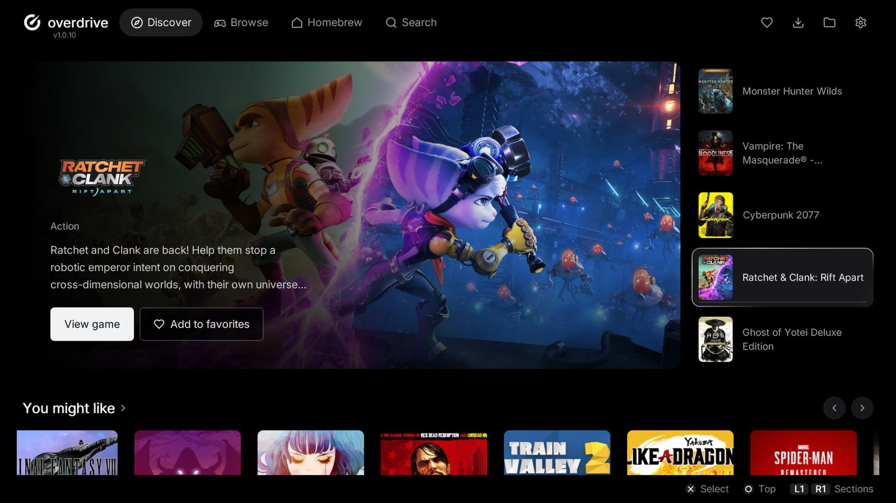
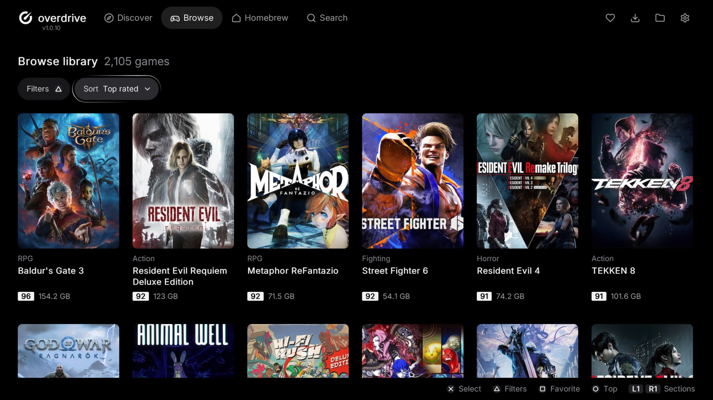
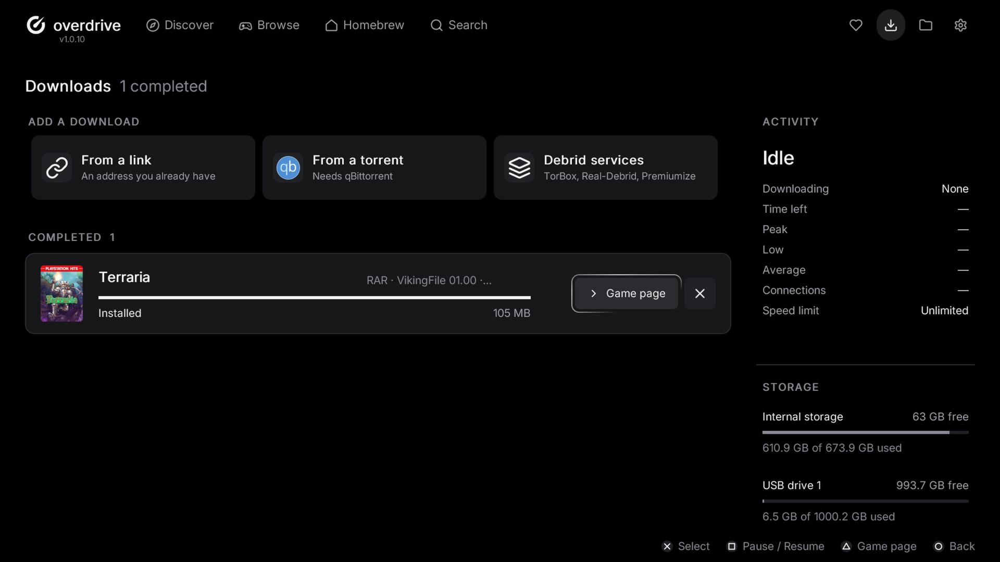

<div align="center" dir="ltr">
  
</div>

<div align="center" dir="ltr">
  <h5><a href="README.md">English</a> ·
  <b>Русский</b></h5>
</div>

<div align="center" dir="ltr">
  <h3><b>Overdrive для PlayStation 4.</b><br>
  Открытый игровой магазин, переносимый с PS5-хоумбрю на взломанную PS4 — работа в процессе.</h3>
</div>

<div align="center" dir="ltr">
  <a href="#статус">Статус</a> ·
  <a href="#возможности">Возможности</a> ·
  <a href="#требования">Требования</a> ·
  <a href="#сборка">Сборка</a> ·
  <a href="#тестирование-на-консоли">Тестирование</a> ·
  <a href="#авторы">Авторы</a>
</div>

> [!IMPORTANT]
> **На консоли пока ничего не запускается.** В этом репозитории — рабочая база переноса:
> полный кодбейс Overdrive, нативный PS4-хост и пайплайн сборки под тулчейн
> [Open Orbis](https://github.com/OpenOrbis/OpenOrbis-PS4-Toolchain). Первый выход на железо
> запланирован; до тех пор любой артефакт считается непроверенным. Актуальный план и статус —
> в [docs/PS4.md](docs/PS4.md).

> [!NOTE]
> Overdrive начинался как PS5-хоумбрю: оригинальный проект был закрыт, последнюю сборку
> декомпилировали и полностью восстановили исходники — см.
> [gitlab.com/myluxy/overdrive](https://gitlab.com/myluxy/overdrive) и зеркало
> [github.com/Stintik-123/Overdrive](https://github.com/Stintik-123/Overdrive). Этот репозиторий
> переносит тот же магазин на PS4. Интерфейс, каталог и архитектура — те же; отличается только
> консольный слой.

<div align="center" dir="ltr">
  
</div>
<div align="center" dir="ltr">
  
  
</div>

*Скриншоты сняты с PS5-сборки. PS4-порт рисует тот же интерфейс тем же софтверным рендером;
скриншоты с консоли заменят их после первого выхода на железо.*

## Что это

Overdrive — игровой магазин для взломанных консолей: листайте каталог из 3400+ комьюнити-загрузок,
качайте прямо во внутреннее хранилище или на USB-накопитель, распаковывайте архивы и наводите
порядок в файлах — всё с дивана, геймпадом. На PS5 он выходит нативным хоумбрю-приложением под
`PPSA99058`. На PS4 тот же React-интерфейс работает внутри QuickJS, рисуется тем же софтверным
рендером во фреймбуфер, а ввод и звук обеспечивает SDL2 поверх libc из
[Open Orbis](https://github.com/OpenOrbis/OpenOrbis-PS4-Toolchain).

Фреймворк под капотом — ps5-react (React в QuickJS + нативный C++-хост) — переносим по дизайну:
платформенный слой, который нужен консоли, невелик, и его PS4-реализация лежит в
[`ps5-react/native/ps4`](ps5-react/native/ps4/README.md).

## Статус

| Область | Состояние |
| --- | --- |
| Интерфейс, каталог, 17+ языков | ✅ унаследовано от Overdrive без изменений |
| Desktop-превью (ПК, SDL2) | ✅ работает как в апстриме: `npm run preview` |
| PS4-хост (`ps5-react/native/ps4`) | 🟡 написан, **ещё не компилировался** под Open Orbis |
| Пайплайн сборки (`packaging/build-ps4.sh`, `tools/build_ps4.py`) | 🟡 написан, **ещё не запускался** |
| Загрузки во внутреннее хранилище / на USB | 🟡 реализовано в хосте; нужно подтверждение на консоли |
| Распаковка RAR | 🔴 заглушка: на Open Orbis нет процессов, воркер на доработке |
| Помощь в установке PKG | 🔴 сознательно вне рамок: PKG ставит инструментарий HEN |
| Воспроизведение видео | 🔴 опциональный FFmpeg-порт, по умолчанию выключен |
| fPKG-упаковка и установка на консоль | 🔴 ждёт первой сессии на железе |
| Совместимость с прошивками / HEN | ❓ неизвестно, пока взломанная PS4 не запустит ELF |

Подробная таблица по компонентам, риски и чек-лист выхода на железо — в
[docs/PS4.md](docs/PS4.md).

## Возможности (цель, из апстрима)

- **Более 3400 игр** для поиска, с подборкой **«Лучшие по оценкам»** и рекомендованной игрой
- **Просмотр всей библиотеки** с фильтрами, сортировкой, оценками и размерами загрузок
- **Загрузка прямо на консоль** — во внутренний накопитель или на любой USB-накопитель, со скоростью и местом в реальном времени
- **Debrid-сервисы** (TorBox, Real-Debrid, Premiumize): вставьте ссылку или магнит — консоль скачает то, что подготовил сервис
- **Избранное**, **поиск** с экранной клавиатурой и страница **«Файлы»**, где видно, что лежит на накопителях
- **17+ языков**, унаследованных от PS5-сборки
- Сделано под геймпад: <kbd>L1</kbd> <kbd>R1</kbd> — переключение разделов, <kbd>✕</kbd> — выбрать, <kbd>◯</kbd> — назад

На PS4 функции, опирающиеся на PS5-сервисы, заменяются уместным поведением: запросы на установку
PKG честно сообщают, что установкой занимается HEN-инструментарий, захват каталога через браузер
недоступен, а самообновление ожидаемо придёт через обычные каналы PS4-хоумбрю вместо смены образа
из самого приложения.

## Требования

Для тестирования, когда порт дойдёт до консоли:

- **Взломанная PS4** на прошивке, поддерживаемой сценой (например 9.00 с интегрированным HEN-payload),
  с активным **PS4-HEN** или эквивалентным лоадером
- USB-накопитель или достаточно места во внутреннем хранилище
- Геймпад DualShock 4 (или DualSense)

Для разработки, уже сегодня:

| Зависимость | Назначение |
| --- | --- |
| Node.js, npm, Python 3.12+ | Сборка JS, запекание ассетов, драйверы сборки |
| CMake, Ninja, git | Конфигурация и сборка нативного кода |
| SDL2, libcurl, libarchive, xz, OpenSSL, zlib | Зависимости desktop-превью |
| Тулчейн Open Orbis | Кросс-сборка под PS4 (`OO_PS4_TOOLCHAIN`) |

## Сборка

Начните с desktop-превью — консольный тулчейн не нужен, а весь интерфейс, включая пути, которыми
пользуется PS4-хост, проверяется на ПК:

```sh
npm run setup          # один раз после клонирования
npm run preview        # магазин в окне на вашем ПК
```

Дерево этапа PS4 (`eboot.elf` и данные приложения рядом) требует установленного тулчейна Open Orbis;
точные шаги подготовки окружения — в [docs/PS4.md](docs/PS4.md):

```sh
export OO_PS4_TOOLCHAIN=/путь/к/OpenOrbis-PS4-Toolchain
npm run build:ps4      # создаст dist/<title>-ps4/ с eboot.elf и данными приложения
```

Скрипт останавливается на дереве этапа осознанно: превращение его в устанавливаемый fPKG и запуск
на консоли — шаги, требующие проверки на железе, они отслеживаются в
[docs/PS4.md](docs/PS4.md).

## Тестирование на консоли

План тестов — что ставить, что проверять, что снимать (klog, дерево песочницы приложения, скриншоты) —
описан в [docs/PS4.md](docs/PS4.md), чтобы следующая сессия могла продолжить с середины. Коротко:
загрузка в HEN, установка или запуск сгруженного приложения, проверка UI в 1080p, проход
«Обзор → Библиотека → Загрузки» на USB-накопитель — и фиксация всего, что пошло не так.

## Решение проблем

На железе пока ничего не запускалось, поэтому раздел честный, а не полезный — в нём собраны
*ожидаемые* сбои и их диагностика:

| Симптом | Вероятная причина | Куда смотреть |
| --- | --- | --- |
| Сборка падает на отсутствии SDL2/curl/libarchive | Порты библиотек Open Orbis не установлены там, где ищет тулчейн | [docs/PS4.md](docs/PS4.md) |
| Чёрный экран после запуска | GL-контекст не поддержан PS4-портом SDL2; переходить на вывод через surface | [ps5-react/native/ps4/README.md](ps5-react/native/ps4/README.md) |
| RAR-архивы не распаковываются | Ожидаемо: RAR-воркер на PS4 заглушен | [rar_worker_process.cpp](ps5-react/native/ps4/rar_worker_process.cpp) |
| Пустой каталог на консоли | Не поднялась сеть; проверьте TLS-стек порта curl | [docs/PS4.md](docs/PS4.md) |

## Авторы

- **half144** и контрибьюторы **PS5 React** — фреймворк, на котором стоит магазин (GPL-3.0-or-later)
- Автор **Overdrive** — оригинальный PS5-магазин, декомпилированный и открытый заново
- **Stintik-123** — зеркало Overdrive и этот перенос на PS4
- Команда **Open Orbis** и PS4-сцена — тулчейн, порты библиотек и экосистема лоадеров

Лицензия: [GPL-3.0-or-later](LICENSE) (фреймворк в `ps5-react/` несёт свои файлы лицензий
и атрибуции).
