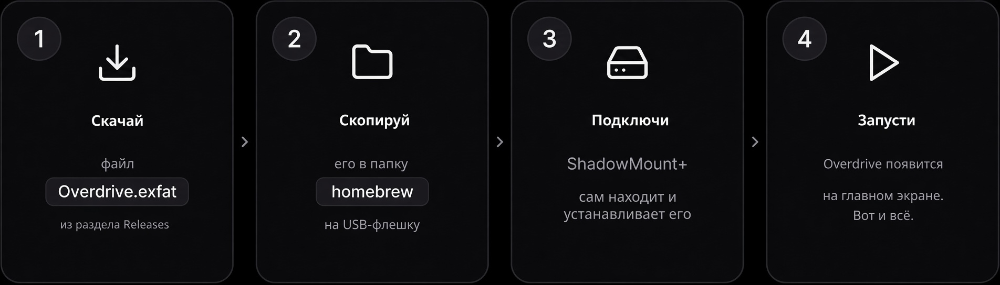

<p align="center">
  <picture>
    <source media="(prefers-color-scheme: dark)" srcset=".github/readme/logo-dark.svg">
    
  </picture>
</p>

<p align="center">
  <b>Ваш игровой магазин для PS5.</b><br>
  Восставший из мёртвых, собранный заново из собственного бинарника, с полностью открытым исходным кодом.
</p>

<p align="center">
  <a href="https://github.com/MyLuxy/overdrive/releases/latest"></a>
  <a href="https://github.com/MyLuxy/overdrive/releases"></a>
  
</p>

<p align="center">
  <a href="#установка-в-четыре-шага">Установка</a> ·
  <a href="#возможности">Возможности</a> ·
  <a href="#обновления">Обновления</a> ·
  <a href="#решение-проблем">Решение проблем</a> ·
  <a href="#сборка-своими-руками">Сборка своими руками</a>
</p>

> [!NOTE]
> Оригинальный проект Overdrive был закрыт, поэтому я декомпилировал последнюю выпущенную сборку,
> восстановил полный исходный код и собрал его заново.

<p align="center">
  
</p>
<p align="center">
  
  
</p>

## Возможности

- **Более 1800 игр** для поиска, с подборками **«Лучшие по оценкам»**, **«Новые релизы»** и отдельной рекомендованной игрой
- **Просмотр всей библиотеки** с фильтрами, сортировкой, оценками и размерами загрузок — всё видно сразу
- **Загрузка прямо на консоль** — во внутренний накопитель или на любой USB-накопитель, со скоростью и занятым местом в реальном времени
- **Избранное**, **поиск** с экранной клавиатурой и страница **«Файлы»**, где видно, что лежит на накопителях, и можно это почистить
- **13 языков**: английский, немецкий, испанский, французский, португальский (Бразилия), русский, индонезийский, японский, китайский (упрощённый), арабский, урду, хинди, бенгальский
- **Обновляется сам**: новая версия устанавливается прямо с консоли, без компьютера
- Сделано под геймпад: <kbd>L1</kbd> <kbd>R1</kbd> — переключение разделов, <kbd>✕</kbd> — выбрать, <kbd>○</kbd> — назад

## Установка в четыре шага

<p align="center">
  
</p>

### Перед началом

Вам нужна **взломанная PS5** с запущенным **[ShadowMount+](https://github.com/drakmor/ShadowMountPlus)** —
это payload, который сам устанавливает образы `.exfat`. Если при включении консоли ShadowMount+
показывает уведомление, значит всё готово. Также понадобятся **USB-накопитель** и **компьютер**.

<p align="center">
  <a href="https://github.com/MyLuxy/overdrive/releases/latest/download/Overdrive.exfat"></a>
</p>

<table>
<tr>
<td width="64" align="center" valign="top"></td>
<td>

**Скачайте `Overdrive.exfat`** по кнопке выше или из
[последнего релиза](https://github.com/MyLuxy/overdrive/releases/latest). Это единственный нужный
файл. Оставьте его как есть: не распаковывайте и не меняйте `.exfat` в конце имени.

</td>
</tr>
<tr>
<td align="center" valign="top"></td>
<td>

**Скопируйте его на USB-накопитель в папку `homebrew`.** Подключите накопитель к компьютеру,
создайте в корне накопителя папку с именем ровно `homebrew` (все буквы строчные) и скопируйте
в неё `Overdrive.exfat`:

```text
USB-накопитель
└── homebrew
    └── Overdrive.exfat
```

Накопитель должен быть отформатирован в **exFAT** — так отформатировано большинство накопителей
из коробки, и именно этот формат читает PS5.

</td>
</tr>
<tr>
<td align="center" valign="top"></td>
<td>

**Вставьте накопитель в PS5.** ShadowMount+ проверяет наличие новых файлов каждые несколько секунд:
он находит Overdrive, монтирует и устанавливает его, а по завершении показывает уведомление.
Ничего нажимать не нужно.

</td>
</tr>
<tr>
<td align="center" valign="top"></td>
<td>


**Откройте Overdrive с главного экрана.** Ищите эту иконку. Приятной игры!

</td>
</tr>
</table>

Кроме того, файл можно перенести во внутренний накопитель консоли с помощью **любого FTP-клиента** —
тоже в папку `homebrew`: `/data/homebrew/Overdrive.exfat`.

## Обновления

Overdrive нужно установить вручную только один раз. Когда выходит новая версия, приложение само
сообщает об этом через несколько секунд после запуска:

1. Появляется окно с номером новой версии и списком изменений. Нажмите **«Установить»**.
2. Overdrive скачивает обновление, проверяет его и ставит на место старого.
3. Когда всё готово, приложение **закрывается само**. Откройте его снова — вы уже на новой версии.

Для обновления нужно около **600 МБ свободного места** на накопителе, где лежит Overdrive.
Файл `update.zip` в каждом релизе — это тот самый пакет, который скачивает приложение; вам он
самому не нужен.

## Решение проблем

<details>
<summary><b>Overdrive не появляется на главном экране</b></summary>
<br>

- Убедитесь, что **ShadowMount+ запущен**: при старте он показывает уведомление.
- Проверьте папку: она должна называться ровно `homebrew` и лежать в **корне** накопителя, а не
  внутри другой папки.
- Проверьте, что файл всё ещё заканчивается на **`.exfat`**. Некоторые системы скрывают расширения:
  файл, переименованный в `Overdrive.exfat.zip` или распакованный в папку, найден не будет.
- Подождите минуту: ShadowMount+ ждёт, пока файл полностью скопируется, и только потом
  устанавливает его.

</details>

<details>
<summary><b>После обновления приложение всё ещё показывает старую версию</b></summary>
<br>

Новая версия установлена, но консоль всё ещё держит в памяти старую. **Перезагрузите консоль** и
откройте Overdrive снова; приложение само об этом сообщит, если такое случится дважды подряд.

</details>

<details>
<summary><b>Обновление сообщает, что недостаточно места</b></summary>
<br>

Обновление скачивается рядом с установленным приложением, поэтому на накопителе с Overdrive нужно
около 600 МБ свободного места. Освободите место на этом накопителе и нажмите **«Повторить»**.
На этот момент ничего ещё не изменено.

</details>

<details>
<summary><b>Обновление сообщает, что не удалось заменить приложение</b></summary>
<br>

Установите вручную: скачайте `Overdrive.exfat` из
[последнего релиза](https://github.com/MyLuxy/overdrive/releases/latest), закройте Overdrive и
скопируйте новый файл поверх старого в папку `homebrew`.

</details>

<details>
<summary><b>Как удалить Overdrive?</b></summary>
<br>

Сначала удалите `Overdrive.exfat` из папки `homebrew`, а затем удалите его иконку с главного экрана.
В обратном порядке ShadowMount+ снова найдёт файл и вернёт иконку на место.

</details>

## Сборка своими руками

<details>
<summary><b>Что находится в этом репозитории</b></summary>
<br>

| Путь | Что это |
| --- | --- |
| `app/` | Само приложение: исходники на JSX, состояние, ресурсы, данные каталога и `app.json` (title id `PPSA99058`, версия, возможности) |
| `ps5-react/` | Фреймворк, на котором оно работает, взятый из [half144/ps5-react](https://github.com/half144/ps5-react) |
| `packaging/make-exfat.sh` | Собирает образ exFAT, который устанавливает ShadowMount+ |
| `.github/workflows/build.yml` | Процесс сборки |

</details>

<details>
<summary><b>Как был восстановлен исходный код</b></summary>
<br>

Overdrive — это приложение на React, работающее на [ps5-react](https://github.com/half144/ps5-react),
и весь его JavaScript-бандл лежит открытым текстом внутри `eboot.bin`. Сборщик объединяет все модули
в одну область видимости, поэтому импорты между модулями превращаются в простые имена; поскольку
каждое имя верхнего уровня остаётся уникальным, можно снова определить, какой модуль объявляет это
имя. Так бандл удалось разбить обратно на его 137 исходных модулей с настоящими строками
`import`/`export`, сверяя результат с оригинальным бандлом, пока не совпала каждая связь импорта.

То, что сборщик отбрасывает, вернуть не удалось: большинство комментариев, синтаксис JSX (теперь это
вызовы вида `jsx(View, {…})`) и `const`/`let` (теперь `var`). На поведение приложения это никак не
влияет.

</details>

<details>
<summary><b>Сборка</b></summary>
<br>

Каждый push запускает сборку на `ubuntu-24.04` с clang 18 и загружает `Overdrive.exfat` как артефакт
workflow; тег `v*` дополнительно публикует релиз с `Overdrive.exfat` и `update.zip`.

Та же сборка локально, на любом Linux с пакетами, которые устанавливает workflow (`clang-18`,
`llvm-18`, `cmake`, `ninja-build`, `nodejs`, `npm`, `zlib1g-dev`, `build-essential`,
`pkg-config`, `unzip`, `curl`, `exfatprogs`, а также Pillow из `ps5-react/requirements.txt`):

```sh
cd ps5-react
python3 tools/build_ps5.py --app-dir ../app --llvm /usr/bin
sudo ../packaging/make-exfat.sh dist/PPSA99058 ../Overdrive.exfat
```

При сборке закреплённые зависимости скачиваются в `ps5-react/.deps`, а папка приложения, `.zip` и
`.receipt.json` записываются в `ps5-react/dist`. Результат проверяется автоматически
(`tools/verify.py`), поэтому успешная сборка означает, что структура payload и подписи в порядке.
`--llvm /usr/bin` указывает на системный clang; по умолчанию в апстриме используется путь к LLVM
из Homebrew, поскольку поддерживаемая среда разработки — macOS.

Образ — это обычный том exFAT, корнем которого является папка приложения, с кластерами 64 КиБ и
меткой `OVERDRIVE`. Чтобы выпустить новую версию, поднимите версию в `app/version.js` и
`app/app.json` и отправьте тег `v*`: установленные приложения предложат обновление при следующем
запуске.

</details>

<details>
<summary><b>Исправления относительно оригинального ps5-react</b></summary>
<br>

Два исправления во встроенном фреймворке, оба в инструментах сборки и оба обнаружены при сборке на
Linux:

- `ps5-react/tools/common.py` читал строку `git apply --summary` с фиксированным числом пробелов,
  из-за чего режим файла приклеивался к пути (`100644 <путь>`) и любая чистая выгрузка зависимости
  падала на первом же патче, создающем файл. Теперь строка разбивается по пробельным символам.
- `ps5-react/tools/build_ps5.py` открывал `data.tar.zst` из закреплённого пакета LLVM через
  `tarfile`, а тот читает zstd только начиная с Python 3.14, тогда как документированный минимум —
  3.12. Теперь есть откат на команду `zstd`.

Больше во фреймворке ничего не изменено.

</details>

## Благодарности

- **[MyLuxy](https://github.com/MyLuxy)** — декомпилировал Overdrive, восстановил его исходный код и собрал заново.
- **[Stintik-123](https://github.com/Stintik-123)** — добавил русский язык.
- **[ps5-react](https://github.com/half144/ps5-react)** — фреймворк, на котором всё работает.
- **[ShadowMount+](https://github.com/drakmor/ShadowMountPlus)** от drakmor — устанавливает приложение.

`ps5-react/` распространяется под GPL-3.0-or-later и содержит собственные `LICENSE`,
`LICENSE-ATTRIBUTION` и `NOTICE`. Все уведомления о зависимостях копируются в `notices/` внутри
собранного приложения, а `ps5-react/docs/DEPENDENCIES.md` перечисляет их с указанием источников.

<sub>Overdrive — неофициальный homebrew-проект, не связанный с Sony Interactive Entertainment и не
одобренный ею. PlayStation и PS5 — товарные знаки Sony Interactive Entertainment.</sub>

<sub>Русский перевод сделан в [форке Stintik-123](https://github.com/Stintik-123/Overdrive).</sub>
